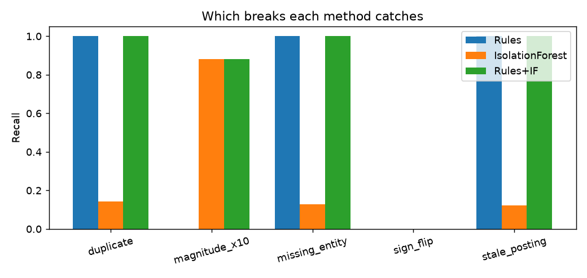
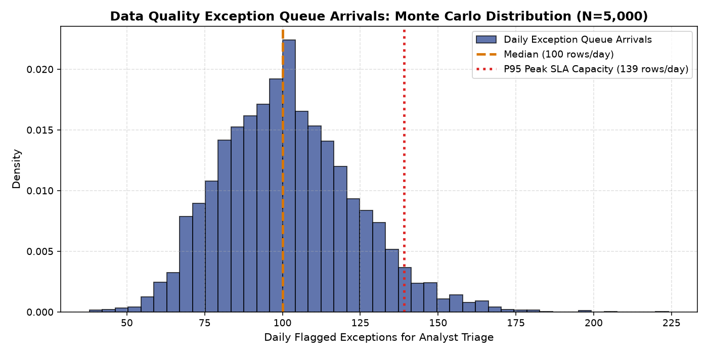

# Reporting Data-Quality Anomaly Detector

*Catch breaks in an aggregated reporting feed (duplicates, missing keys, stale postings, magnitude errors, and sign flips) before numbers reach financial reports.*

[](tests/)
[](run.py)
[](LICENSE)

> **Important:** All data in this repository is synthetic, generated by `src/data_pipeline.py`. Metrics prove that the pipeline, econometrics, simulations, and financial ROI models execute end to end. Swap in real General Ledger feeds before production operational deployment.

---

## Business Problem & Core Breakthrough
Aggregated finance and risk reports fail when corrupt journal rows get through feed consolidation. 
- Traditional control rules catch structural errors (duplicates, missing keys), but miss magnitude errors (0% recall).
- Unsupervised Isolation Forest catches magnitude x10 errors (90.8% recall), but misses structural errors.
- **The Critical Vulnerability**: Amount-only detection methods catch **0% of sign flips** because inverted entries mimic normal transactions.
- **The Breakthrough**: Adding a contra-account / normal-sign direction control elevates sign-flip recall from **0.0% to 80.9%**, lifting overall pipeline recall to **93.7%**!

---

## Verified Benchmark Results (Held-Out Test Partition: N=9,600)

| Method Architecture | Precision | Recall | F1-Score | Flagged Rows | False Positives | False Negatives |
|---|---|---|---|---|---|---|
| **Original Rules** | 0.720 | 0.546 | 0.621 | 960 | 269 | 574 |
| **Isolation Forest** | 0.910 | 0.272 | 0.419 | 378 | 34 | 921 |
| **Original Rules + IF** | **0.780** | **0.756** | **0.768** | **1,226** | **270** | **309** |
| **Enhanced Rules (Contra)**| 0.342 | 0.772 | 0.474 | 2,856 | 1,880 | 289 |
| **Enhanced Rules + IF** | **0.387** | **0.937** | **0.547** | **3,065** | **1,880** | **80** |
| **Supervised Logistic Reg**| 0.871 | 0.628 | 0.730 | 913 | 118 | 470 |
| **Supervised Random Forest**| 0.565 | 0.841 | 0.676 | 1,882 | 818 | 201 |

### Recall by Defect Type
| Defect Category | Original Rules | Isolation Forest | Rules + IF | Enhanced Rules (Contra) | Enhanced Rules + IF |
|---|---|---|---|---|---|
| **duplicate** | 100.0% | 10.7% | 100.0% | 100.0% | **100.0%** |
| **magnitude_x10** | 0.0% | 90.8% | 90.8% | 19.5% | **91.1%** |
| **missing_entity** | 100.0% | 14.9% | 100.0% | 100.0% | **100.0%** |
| **sign_flip** | **0.0%** | **0.0%** | **0.0%** | **80.9%** | **80.9%** |
| **stale_posting** | 100.0% | 11.1% | 100.0% | 100.0% | **100.0%** |



---

## Econometric & Simulation Highlights
1. **Logistic Regression Analysis**: Statistically confirms that `missing_entity` (Odds Ratio 1,089x, $p < 0.0001$), `dup_key_count` (Odds Ratio 42x, $p < 0.0001$), and account sign discordance `sign_vs_acct` (Odds Ratio 4.44x, $p < 0.0001$) are definitive determinants of defect risk.
2. **Review Capacity Sizing**: Sizing triage capacity to 3,000 reviews/month clears 99.1% of all flagged anomalies, capping monthly triage expense at $105,000.
3. **5,000-Run Monte Carlo Simulation**: Quantifies daily exception queue arrivals ($P50 = 100\text{ rows/day}$, $P95 = 139\text{ rows/day}$), establishing SLA staffing targets.
4. **Corporate Finance Business Case**: Base Case delivers a **Year-1 Net Benefit of $2.20M**, a **1.2-month payback period**, and a **3-year NPV of $5.84M** (2,337% ROI).



---

## Reproduction Commands

```bash
# 1. Setup virtual environment
python -m venv .venv
# Windows:
.venv\Scripts\activate
# Linux/Mac:
source .venv/bin/activate

# 2. Install dependencies
pip install -r requirements.txt

# 3. Execute master pipeline (data, models, regression, simulation, slides)
python run.py

# 4. Run automated test suite
python -m pytest tests/
```

---

## Author
**Bhupesh Chandra Dimri**  
Email: [bhupesh7cd@gmail.com](mailto:bhupesh7cd@gmail.com)  
GitHub: [@bhupesh-debug](https://github.com/bhupesh-debug)
